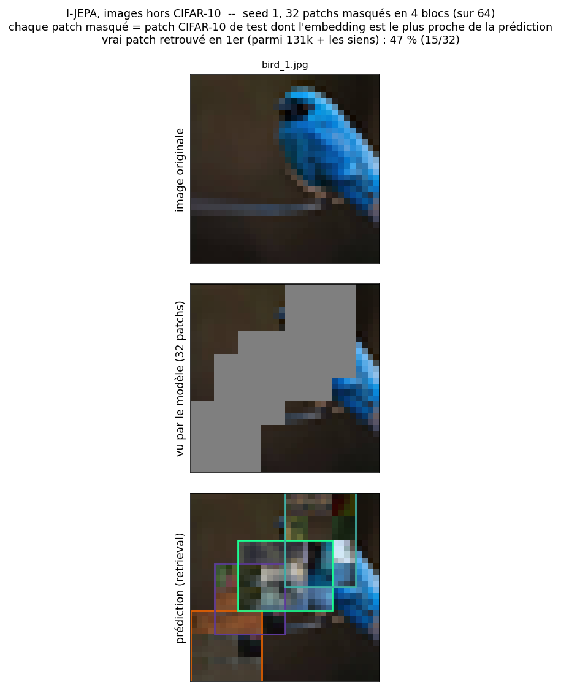

# Project progress

## Latest update: analysis of the pre-training run and tests on images outside CIFAR-10

Two folders were added: [`result_analysis/`](result_analysis/), which evaluates the 30-epoch run, and [`experimentation/`](experimentation/), which tests the model on our own images.

### What was added

- **[`plot_loss.py`](result_analysis/plot_loss.py)**: plots the loss logged every 50 steps in `logs/train.log` ([`loss_par_step.png`](result_analysis/loss_par_step.png)). It drops to 0.151 at step 550, rises to ~0.28 around epoch 15 as the EMA target gets richer, and ends at 0.265.
- **[`check_collapse.py`](result_analysis/check_collapse.py)**: measures the spread of the target encoder embeddings on 1024 test images, compared with a random encoder. No collapse: normalised std 0.087 (ideal ~0.088), no dead dimension, effective rank 65 per image (37 for the random encoder).
- **[`predicted_fill.py`](result_analysis/predicted_fill.py)**: I-JEPA predicts embeddings, not pixels, so each masked patch is shown as the test patch whose target embedding is nearest to the prediction ([`predicted_samples.png`](result_analysis/predicted_samples.png)). The true patch is the nearest neighbour in 51% of cases among 131k patches.
- **[`RESULTATS.md`](result_analysis/RESULTATS.md)**: summary of the unit tests (157 passed), the run, the collapse check and the predictions.
- **[`experimentation/test_image.py`](experimentation/test_image.py)**: crops and resizes any image in the folder to 32x32 and runs the same visualisation. Tried on [`img/bird1.jpg`](experimentation/img/bird1.jpg) ([`prediction_bird1_v1.png`](experimentation/prediction_bird1_v1.png)).

### Assessment

The pipeline works, but the predictions are clearly not good. On the bird image the true patch is found in only ~46% of cases, and the retrieved patches only match local colours and textures: with the head masked, the model fills it with brown-green background textures and never recovers the shape of the bird or the branch.

### Next steps

- A larger embedding dimension.
- Re-training on a higher-resolution dataset (e.g. STL-10 or Tiny ImageNet at 64x64), since CIFAR-10 is only 32x32 and the model cannot run at another resolution without re-training.

The detailed plan for these next steps is in [TODO.md](TODO.md).
