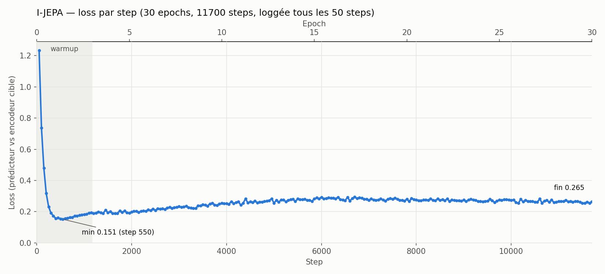
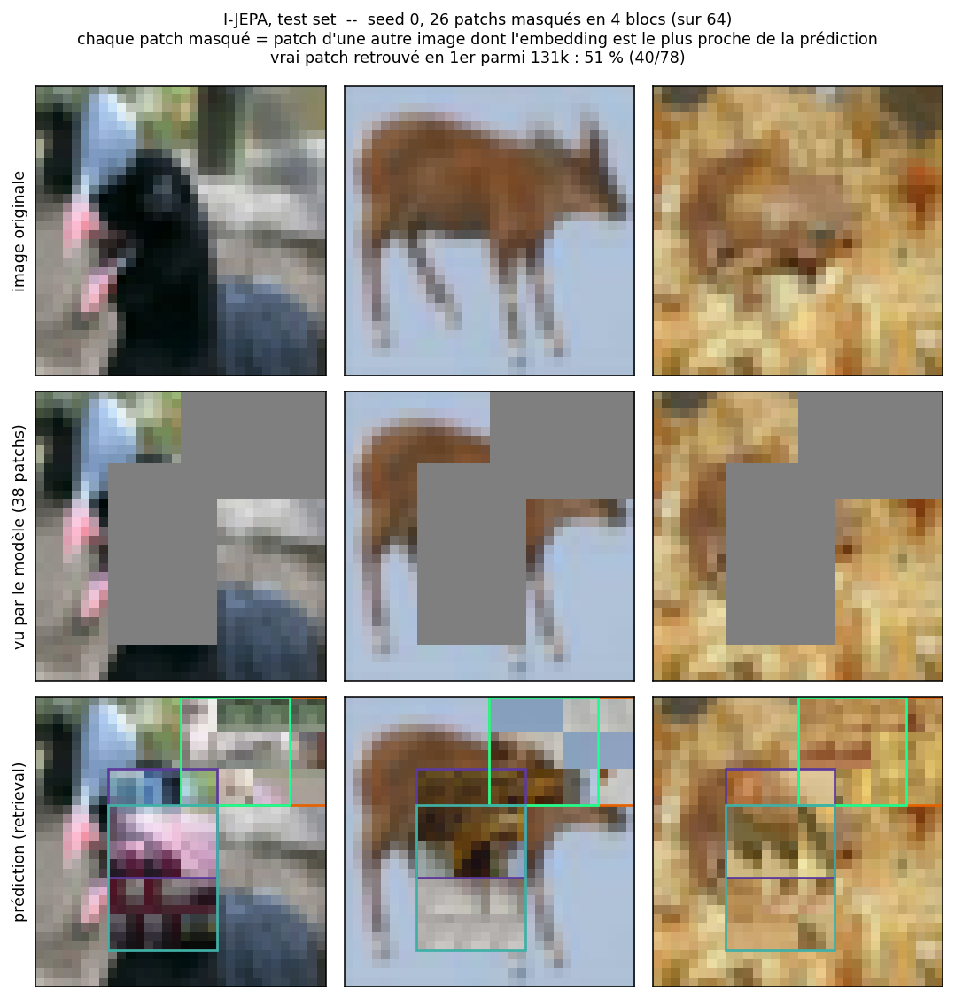

# Synthèse des résultats — I-JEPA sur CIFAR-10

*Run du 13–14/10/2026, checkpoint `checkpoints/cifar10_d128/jepa.weights.h5` (run `cifar10_d128`).*

## En bref

| Vérification | Résultat | Verdict |
|---|---|---|
| Tests unitaires (`pytest`) | 157 passés, 0 échec | ✅ |
| Pré-entraînement | 30/30 epochs, loss finale 0,260 (moyenne epoch 30) | ✅ terminé |
| Collapse de l'encodeur cible | std normalisée 0,087 (idéal ~0,088), 0 dim. morte | ✅ pas de collapse |
| Qualité des représentations (linear probe) | — | ⏳ à faire |

## 1. Tests unitaires

`python -m pytest -q` : **157 passed** en 76 s, sur 8 fichiers (attention, data, masking, model, patching, predictor, transformer, visualise).
Les 767 warnings sont des `DeprecationWarning` de NumPy 2 / gast, sans impact sur les résultats.

## 2. Pré-entraînement

| Paramètre | Valeur |
|---|---|
| Données | CIFAR-10 train, patchs 4×4 (grille 8×8, 64 tokens) |
| Encodeur | ViT, d = 128, 4 blocs, 4 têtes |
| Prédicteur | d = 64, 2 blocs |
| Paramètres | 916,4K entraînables, 820,1K gelés (encodeur cible, positions) |
| Schedule | 30 epochs × 390 steps = 11 700 steps, batch 128 |
| LR | warmup linéaire 3 epochs jusqu'à 1e-3, puis cosine jusqu'à 0 |
| EMA | 0,996 → 1,0 |
| Matériel | CPU uniquement (pas de GPU TensorFlow sous Windows natif), ~8 min/epoch, ~4 h au total |

### Évolution de la loss



*Généré par `plot_loss.py` à partir de `logs/cifar10_d128.log` (loss loggée tous les 50 steps).*

| Epoch | 1 | 2 | 5 | 10 | 15 | 20 | 25 | 30 |
|---|---|---|---|---|---|---|---|---|
| Loss moyenne | 0,449 | 0,158 | 0,195 | 0,246 | 0,276 | 0,279 | 0,269 | 0,260 |

- Chute très rapide pendant le warmup : minimum **0,151 au step 550**.
- Remontée progressive jusqu'à ~0,28 vers l'epoch 15–18, puis légère baisse jusqu'à **0,265** au dernier step.
- Cette remontée est attendue en JEPA : la cible (encodeur EMA) devient plus riche, donc plus dure à prédire. La section 3 confirme que ce n'était pas un collapse.

## 3. Vérification du collapse

Script : `check_collapse.py`, sur 1 024 images de test. Encodeur cible entraîné comparé à un encodeur aléatoire.

| Encodeur | Std normalisée | Dims mortes | Rang effectif (par image) | Rang effectif (par token) |
|---|---|---|---|---|
| Aléatoire (réf.) | 0,082 | 0 | 37,2 | 59,4 |
| **Entraîné** | **0,087** | **0** | **65,3** | **86,6** |

*Std normalisée : écart-type par dimension après normalisation L2 (collapse → 0, idéal ≈ 1/√128 ≈ 0,088). Rang effectif : exponentielle de l'entropie des valeurs singulières (max 128).*

- Les embeddings sont bien étalés et aucune dimension n'est morte.
- Le rang effectif est presque **doublé** par rapport à l'aléatoire : l'entraînement a enrichi les représentations.
- La loss très basse au début n'était qu'une phase transitoire.

## 4. Visualisation des prédictions

Script : `predicted_fill.py`. I-JEPA prédit des embeddings, pas des pixels. Chaque patch masqué est donc remplacé par le patch d'une **autre** image de test dont l'embedding (encodeur cible) est le plus proche de la prédiction. La banque contient 2 048 images, soit 131k patchs.



- Le vrai patch est le plus proche voisin de sa prédiction dans **51 % des cas** (40/78), parmi 131k candidats.
- Les patchs retrouvés sont cohérents en couleur et en texture : fond bleu-gris, pelage brun, herbe sèche. Pour les zones d'objet, la cohérence de forme est plus faible.

## 5. Limites et prochaines étapes

- **Linear probe** sur CIFAR-10 (`build_probe_dataset` existe déjà dans `jepa/data.py`) : c'est la seule mesure de l'*utilité* des représentations. Les tests ci-dessus montrent seulement qu'elles ne sont pas dégénérées.
- Loss loggée tous les 50 steps seulement : modifier `jepa/train.py` pour une courbe step par step.
- Entraînement sur CPU : passer par WSL2 ou TensorFlow-DirectML pour accélérer les prochains runs.

## Reproduire

```bash
python -m pytest -q                       # tests unitaires
python -m jepa.train --run cifar10_d128 > logs/cifar10_d128.log 2>&1  # pré-entraînement (~4 h sur CPU)
python result_analysis/plot_loss.py --run cifar10_d128       # courbe de loss
python result_analysis/check_collapse.py --run cifar10_d128  # vérification du collapse
python result_analysis/predicted_fill.py --run cifar10_d128  # visualisation des prédictions
```
